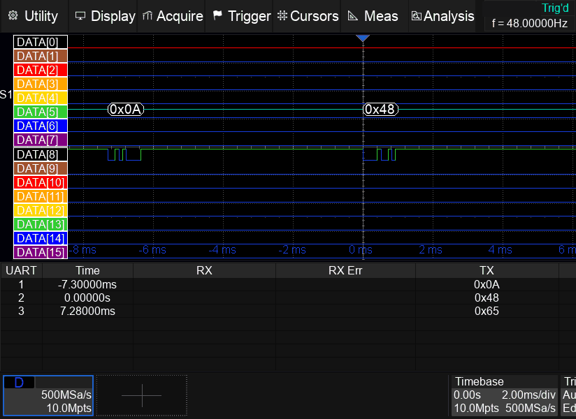
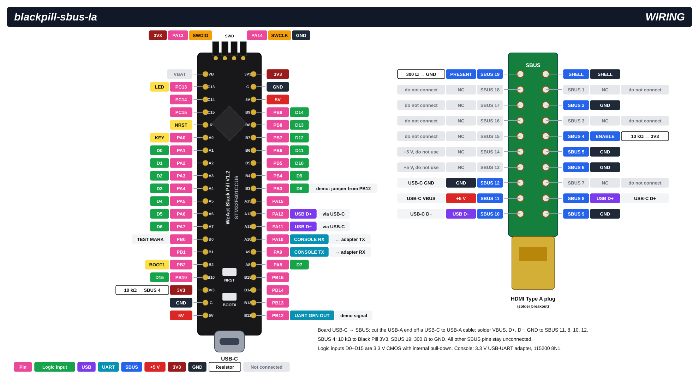

# blackpill-sbus-la

A 16-channel logic-analyzer module for the SBUS connector of Siglent SDS800X HD series oscilloscopes, built on a WeAct Black Pill V1.2 (STM32F401CCU6) board. Tested on an SDS824X HD only.

The oscilloscope recognizes the board as its digital-channel module. The **Digital** menu, channels D0–D15, edge triggering on D channels, UART decoding and digital measurements work from the oscilloscope front panel. No PC is needed once the board is configured.



> Siglent is a trademark of Siglent Technologies Co., Ltd. SDS and SLA1016 are product names of Siglent. STM32 is a trademark of STMicroelectronics; HDMI is a trademark of HDMI Licensing Administrator, Inc.
>
> This project is independent. It is not affiliated with, authorized or endorsed by any of these companies. Their names appear only to describe compatibility, and in the identification reply that the oscilloscope requires from its module.

## Features

- Detected by the oscilloscope as a digital module; channels D0–D15 are drawn on screen.
- 16 logic inputs, 3.3 V CMOS, internal pull-down.
- The sample rate follows the timebase, up to 500 kSa/s. One frame is 1000 samples per channel, one per screen column.
- Edge trigger on any D channel selected on the oscilloscope. The board finds the edge in its own buffer and places it at the trigger point. Horizontal delay is honoured.
- Optional board-side trigger, set from the console. With it the digital trace stays stable while the oscilloscope triggers on an analog channel.
- UART decoding of D channels on buses 1 and 2, RX and TX, with the oscilloscope's event list.
- Measurements on D channels (frequency, period, ±width, ±duty), shown with statistics by the oscilloscope.
- Built-in UART pattern generator on PB12 for demos and self-tests.
- Settings, the generator and the trigger are stored in flash and restored at power-up. The board runs stand-alone, powered by the oscilloscope.
- Serial console (USART1) for configuration and logging.

## Limitations

- **Low sample rate.** The original module samples at up to 1 GSa/s; this board, at up to 500 kSa/s. That covers timebases of 200 µs/div and slower. On faster timebases a frame spans more time than the screen, so the time scale of the D traces is wrong.
- **One screen of memory.** Each frame holds only the 1000 samples shown on screen. There is no deep memory behind the trace.
- **Timing against analog channels.** Digital and analog traces are not synchronized in hardware. They line up only when both are triggered from the same signal. A digital trace triggered by the board alone is not aligned to the analog channels.
- **Update rate.** A few frames per second (3–7 observed), one per oscilloscope acquisition cycle.
- **Protocols.** Only UART decoding of D channels is implemented.
- **Fixed threshold.** Inputs switch at the STM32 logic threshold. The oscilloscope's threshold settings for D channels have no effect.
- **Inputs are 3.3 V only.** Do not apply more than 3.3 V or less than 0 V.
- **D trigger with the decoder.** Turn the decoder on first, then select a D channel as the trigger source. In tests, turning the decoder on or changing the timebase while a D channel was the trigger source froze the oscilloscope. It recovered as soon as the module left the bus (unplug it, or type `disconnect force`). With an analog trigger source these steps are safe.
- **Compatibility.** Tested only on an SDS824X HD with firmware 1.1.6.5. Other models and firmware versions may behave differently.

## Hardware

| Part | Notes |
|---|---|
| WeAct Black Pill V1.2, STM32F401CCU6 | The F401CB variant also fits: the firmware uses 64 KB of flash plus one 64 KB sector for settings. The optional SPI-flash footprint on the back of the board must stay empty: it shares PA4–PA7 with inputs D3–D6. |
| HDMI Type A plug breakout for soldering | Plugs into the SBUS socket of the oscilloscope. Pin numbers follow the HDMI standard; the breakout's pad 20 is the shell. Any male (plug) breakout with all 19 pins brought out will do. Examples of a suitable breakout: [1](https://www.robotics.org.za/image/cache/wp/gj/generic/HDMI-PCB/HDMI-PCB-001-500x500.webp), [2](https://i.ebayimg.com/images/g/LfYAAOSwc~dd30IB/s-l1600.webp), [3 (with pinout)](https://i.ibb.co/1LwDKSR/HDMI-PCB-005.jpg). |
| USB-C to USB-A cable | Cut off the USB-A end and solder the four wires to the HDMI breakout. |
| 10 kΩ resistor | SBUS 4 to Black Pill 3V3. |
| 300 Ω resistor | SBUS 19 to GND. |
| 3.3 V USB-UART adapter | Console, needed only for setup. |
| ST-Link, or a USB-C cable to a PC | Flashing. |

The finished module has an HDMI plug but is not an HDMI device. Label it clearly, so that it is never plugged into a TV, monitor or PC.

### Wiring diagram



### Connection table

**Oscilloscope SBUS connector (HDMI Type A plug)**

| SBUS pin | Signal | Connect to |
|---|---|---|
| 8 | USB D+ | USB cable D+ (usually green) |
| 10 | USB D− | USB cable D− (usually white) |
| 11 | +5 V | USB cable VBUS (red) |
| 12 | GND | USB cable GND (black); also 2, 5, 6, 9 or the shell |
| 4 | Acquisition enable | 10 kΩ resistor to Black Pill 3V3 |
| 19 | Module present (active low) | 300 Ω resistor to GND |
| 1, 3, 7, 15, 16, 17, 18 | Not used | Not connected |
| 13, 14 | +5 V | Not connected |

Without the pull-up on SBUS 4, the oscilloscope detects the module but never starts acquisition (it stays in *Arm*). Without the resistor on SBUS 19, the module fails the oscilloscope's self-test and does not work.

**Black Pill V1.2**

| Black Pill pin | Function | Connect to |
|---|---|---|
| USB-C | USB D+, D−, VBUS, GND | Cut USB cable to SBUS 8, 10, 11, 12 |
| PA1–PA8 | Inputs D0–D7 | Signals under test |
| PB3–PB10 | Inputs D8–D15 | Signals under test |
| G | Ground | Ground of the signals under test |
| 3V3 | 3.3 V | 10 kΩ to SBUS 4 |
| PA9 | Console TX | Adapter RX |
| PA10 | Console RX | Adapter TX |
| G | Console ground | Adapter GND |
| PB12 | UART generator output | Jumper to PB3 (D8) for the demo; otherwise free |
| PB0 | Test marker: high during the oscilloscope's module self-test | Optional, for debugging |
| SWD header: 3V3, SWDIO (PA13), SWCLK (PA14), GND | Debug port | ST-Link, for flashing |

The board is powered by the oscilloscope through SBUS 11. Do not power it from another source while it is plugged into the oscilloscope, and never connect its USB-C port to a PC and to the oscilloscope at the same time.

The ground of the logic inputs is the oscilloscope's ground, which is connected to protective earth. Take the same precautions as with oscilloscope probes.

PB3 and PB4 are JTAG pins after reset; the firmware turns them into plain inputs. SWD flashing and debugging are not affected.

## Building

Requirements:

- Arm GNU Toolchain (`arm-none-eabi-gcc`); version 13.3 was used;
- GNU Make, Git and Python 3. On Windows, GNU Make is installed separately (for example with MSYS2); run it from Git Bash or MSYS2.

```bash
git clone https://github.com/JD72/blackpill-sbus-la.git
cd blackpill-sbus-la
make deps
make
```

`make deps` downloads TinyUSB at a fixed commit into `lib/tinyusb` and applies `patches/tinyusb.patch`. Then TinyUSB's own script fetches the STM32F4 dependencies: HAL, CMSIS and a few libraries this firmware does not use. Run it once; to repeat it, delete `lib/` first. If Python is started as `python` rather than `python3`, run `make PYTHON=python deps`.

`make` produces `build/blackpill-sbus-la.bin`, `.hex` and `.elf`. If the toolchain is not on `PATH`, pass its prefix:

```bash
make TOOLCHAIN_PREFIX=/path/to/arm-gnu-toolchain/bin/arm-none-eabi-
```

The TinyUSB patch adds two hooks to the USBTMC device class and the device core:

- a callback for every SETUP packet;
- a way to send long USBTMC replies that the firmware fills packet by packet, without an application buffer.

## Flashing

**USB DFU (no extra hardware).**

1. Unplug the board from the oscilloscope and disconnect the console adapter.
2. Connect the board's USB-C port to a PC.
3. Hold BOOT0, press and release NRST, then release BOOT0. The board enters the STM32 system bootloader.
4. Run:

```bash
make flash-dfu
```

This needs `dfu-util`; on Windows the bootloader device also needs the WinUSB driver (for example installed with Zadig). STM32CubeProgrammer works too: write the `.bin` file to `0x08000000` over USB.

**ST-Link (SWD).**

```bash
make flash-stlink
```

This needs `STM32_Programmer_CLI` on `PATH`. Unplug the board from the oscilloscope first. Many ST-Link V2 clones power the board through their 3.3 V pin; with an adapter that does not, power the board from USB-C.

Flashing does not touch the settings sector (0x08010000).

## First start

1. Turn the oscilloscope **off**. Plug the module into the SBUS connector.
2. Connect the console adapter (PA9, PA10, GND) to a PC. Open a terminal at 115200 8N1. Lines end with `\n` or `\r\n`.
3. Turn the oscilloscope on. The board starts with it and prints `blackpill-sbus-la ready`; the oscilloscope then detects the module and runs its self-test.
4. Type `show` to see the settings. The factory defaults work with the oscilloscope as they are.

### Demo: decode "Hello" without external signals

Put a jumper between PB12 and PB3 (D8). Then type in the console:

```
ugen 9600 48 65 6C 6C 6F 0D 0A
trig 8 fall 300
save
connect
```

These commands do the following:

- `ugen` sends `Hello\r\n` at 9600 baud on PB12;
- `trig 8 fall 300` makes the board trigger on the first start bit after a pause;
- `save` stores both, so they start again at power-up. During `save` the board drops off the USB bus, and `connect` brings it back.

On the oscilloscope:

1. Set the timebase to **2 ms/div**.
2. Press **Digital** and turn the digital channels on.
3. Open **Decode**, select **Bus1**, turn it on and set the protocol to **UART**, 9600 baud.
4. In **Protocol Signals**, set TX to **D8** and RX to **DIS**.

The bytes `0x48 0x65 …` appear on the bus line and in the event list.

After each power-up the oscilloscope resets the bus sources to DIS, so select D8 again.

## Console commands

| Command | Action |
|---|---|
| `show` | Print USB descriptor values, the reply table, the last reset cause and uptime, and what starts at power-up. |
| `save` / `load` / `default` | Store settings in flash, reload them, or restore factory values. After `save`, run `connect`. |
| `connect` / `disconnect` / `reenum [ms]` | Raise or drop the USB D+ pull-up, or both with a pause (the oscilloscope then detects the module again). `disconnect` and `reenum` are refused while a reply is being sent; add `force` to override. |
| `trig` | Show the board-side trigger and its counters. |
| `trig <0..15> rise\|fall` | Board-side trigger on an edge of input Dn. `trig off` turns it off. |
| `trig <0..15> fall <n>` | Trigger on a falling edge that follows at least `n` high samples (a UART start bit after a pause). |
| `ugen <baud> <hex bytes> [gap <bits>]` | UART generator on PB12: 8N1, 1200–19200 baud, 1–16 bytes in a loop. `ugen off` stops it. |
| `udec` | Show the decoder settings received from the oscilloscope and the last decoding result. |
| `log [0\|1\|2]` | Show or set the log level: events only, plus messages (default), plus hex and transport trace. |
| `baud <n>` | Console speed until reset: 115200, 230400, 460800, 921600 or 1500000. |
| `set vid\|pid\|bcd\|usb 0x<hex>` | USB descriptor fields, for example `set vid 0x1209`. Without the `0x` prefix the number is read as decimal. |
| `set class 0x<cls> 0x<sub> 0x<proto>` | Device class fields of the USB descriptor. |
| `set mfr\|prod\|serial <text>` | USB descriptor strings. |
| `resp [<query> <reply>]` | Show or change the reply table for the oscilloscope's text queries. `resp del <query>` removes an entry. |
| `unknown auto\|<text>\|-` | Reply to queries that are not in the table. |
| `trdl` | Show the horizontal delay received from the oscilloscope and the trigger column. |
| `hcomp [on\|off]` | Redraw correction after a change of horizontal delay (on by default). |
| `pava [off\|calc\|probe\|probei]`, `pava duty pct\|frac`, `pava hdr …` | Measurement replies: computed (`calc`, default), test patterns, duty-cycle scale. |
| `zpat [h\|d] <offset> <hex>`, `zpat clear` | Debugging: insert bytes into decoder replies. |

Settings changed with `trig`, `ugen`, `log`, `baud`, `hcomp`, `pava` and `zpat` last until reset, except that `save` also stores the running generator and trigger.

By default the board uses VID 0x1209 and PID 0x0001. This is a test pair of [pid.codes](https://pid.codes/1209/0001/), meant for private devices that are not redistributed. If you build devices for others, use your own identifiers (`set vid`, `set pid`, then `save`).

The reply to `*IDN?` names the module type the oscilloscope expects (SLA1016) and keeps the field lengths of the original module's reply. The oscilloscope relies on both: with a shorter serial-number field, triggering on D channels stopped working.

## Project layout

| Path | Contents |
|---|---|
| `src/` | Firmware: USBTMC device and command handling (`scpi_emul.c`), sampling and triggering (`sampler.c`), UART decoder and generator, console, settings in flash |
| `board/` | Board definition for TinyUSB, linker script |
| `patches/tinyusb.patch` | Changes to TinyUSB |
| `docs/` | Wiring diagram and demo animation |

## Disclaimer

Connecting home-made hardware to the oscilloscope's SBUS connector is at your own risk. It may damage the oscilloscope or void its warranty. The software is provided without warranty of any kind; see [LICENSE](LICENSE).

## License

MIT, see [LICENSE](LICENSE).

A few files are derived from third-party sources and keep their notices:

- `board/board.h`, `src/tusb_config.h`, `src/usb_descriptors.c` — TinyUSB, MIT;
- `src/stm32f4xx_hal_conf.h` — STMicroelectronics HAL template, BSD-3-Clause;
- `board/stm32f401cc_app.ld` — STMicroelectronics STM32CubeIDE linker script, BSD-3-Clause;
- `patches/tinyusb.patch` contains context lines of TinyUSB, MIT.

`make deps` downloads the rest under its own licenses:

- TinyUSB — MIT;
- STM32F4 HAL — BSD-3-Clause;
- CMSIS device files (cmsis_device_f4) and CMSIS Core — Apache-2.0.

Binary releases built from this repository include code under these licenses.
